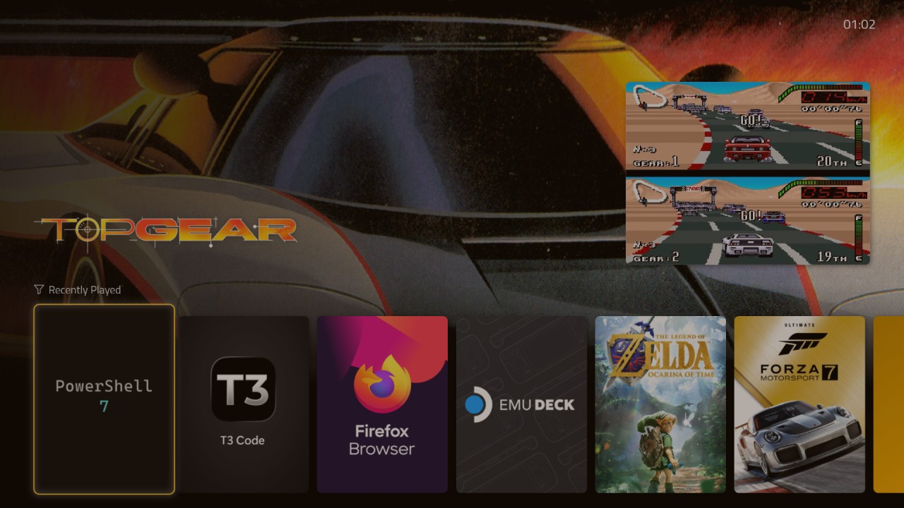
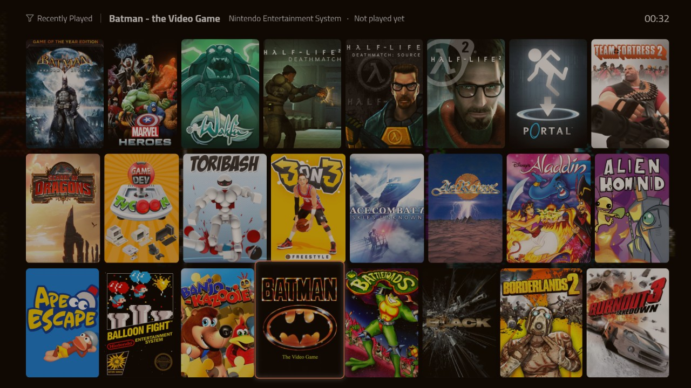

# Scott's setup: ROG Xbox Ally X, Playnite fullscreen as the landing page

A copy of one working handheld setup, so it can be restored or borrowed. It is a snapshot, not an installer: take what you like.

## What it looks like

- **Landing:** the "Row" layout. Full-screen art of the highlighted game, one row of recently played games along the bottom, the gameplay clip as a picture-in-picture box on the right.
- **Library:** press Down from the row. Three whole rows of covers, each cover in its own shape, a one-line header.
- **LB / RB:** 22 categories (filter presets), with the category name shown above the row.
- **Covers and backgrounds rotate** between vetted alternatives so the library does not look the same every day.
- **Apps** (browser, Discord, terminal...) sit in their own row under the games.

## Needs this fork

Several things here are not in upstream Kippix yet: the library view (Mosaic), the Running now row, gameplay video, cover shuffle, the Apps row, Sort and show, and others. They are on the `scott` branch of this fork; `UPSTREAM.md` at the repo root lists each change and its branch. With stock Kippix the settings below still load, and the settings it does not know are ignored.

## Files

| File | What it is |
|---|---|
| `kippix-settings.json` | Kippix's settings with personal data removed (profile, API keys, wishlist, folders, collections, weather, search history, sign-ins). |
| `filter-presets.json` | The 22 Playnite filter presets: name, sort, and the tags, categories or genres each filters on. |
| `tags.txt` | The tag convention the presets rely on, with how many games carry each tag. |
| `autofilterpresets-settings.json` | Automatic Filter Presets add-on: custom order, no per-store or per-platform presets. |
| `backgroundchanger-settings.json` | BackgroundChanger add-on settings (API key removed). |
| `addons.txt` | The Playnite add-ons loaded on the device. |

## Using it

1. Install Playnite, the Kippix theme and helper (this fork's `scott` branch for everything shown), and the add-ons you want from `addons.txt`. The ones the look depends on: BackgroundChanger, Automatic Filter Presets, Extra Metadata Loader (trailers), HowLongToBeat, Playnite Achievements.
2. Close Playnite. Copy the values you want from `kippix-settings.json` into `%APPDATA%\Playnite\ExtensionsData\3f6c2d1e-8a47-4b9e-b1d5-7e2a9c4f0b18\settings.json` (or replace the file, then set your own profile, keys and folders in Kippix's settings).
3. Tag your games. The categories filter on tags named `Play: ...` (how a game is played) and `Style: ...` (what kind it is); see `tags.txt`. A game can carry several. Then recreate the presets from `filter-presets.json` in Playnite's filter panel, and order them in Automatic Filter Presets (order: Custom).
4. Mark launchers and tools with a Playnite category named `Apps`; the Apps row and the "ask before closing" prompt use it.

## The categories

Recently Played, Favorites, Pick up and play, Sofa multiplayer, Online co-op, Online versus, Pausable any time, Can't pause, Works offline, Solo, Racing, RPGs, Arcade, Platformers, Shooters, Fighting, Retro, Never played, Most Played, Installed, Apps, All.

"Pausable any time" is the way to leave out ranked and other can't-stop games; "Can't pause" is the opposite list.
