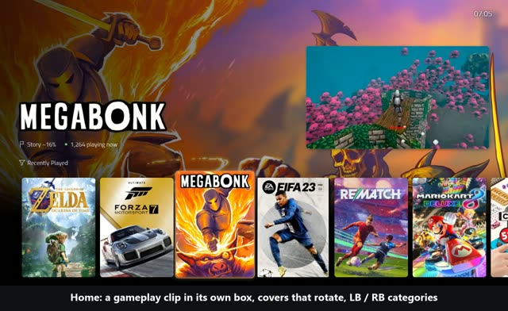
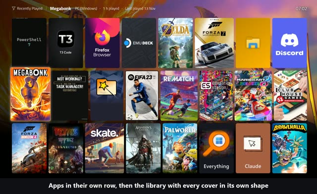
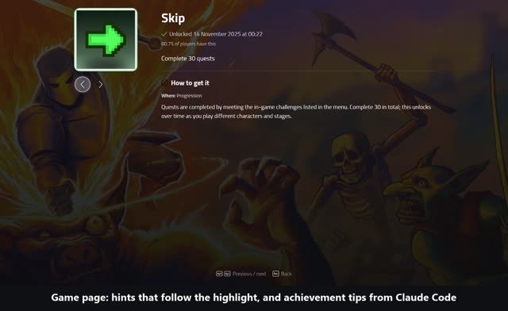
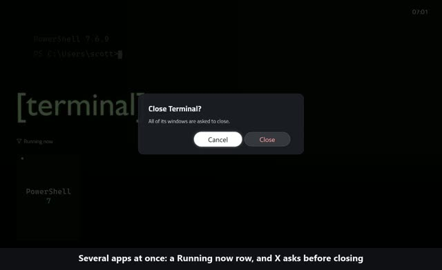
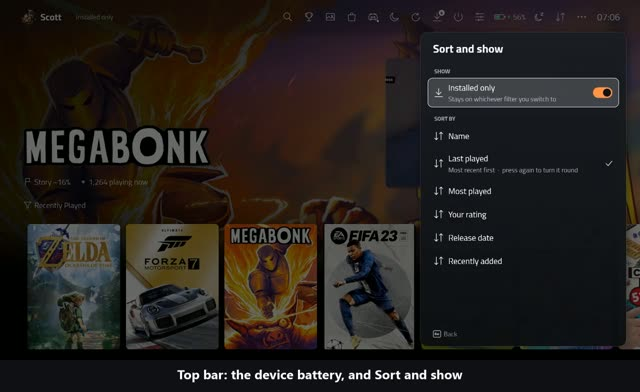
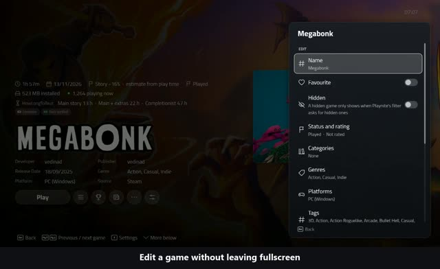

# What this fork adds, on screen

Recorded on a ROG Xbox Ally X running the `scott` branch (Playnite 10.64 fullscreen), driven with the controller. Click a picture to play its clip.

**[The whole thing in one video (2 min 22 s)](https://github.com/ScottWilliamAnderson/Kippix/releases/download/showcase-2026-11-16/kippix-fork-showcase.mp4)**

| | |
|---|---|
|  | **Home.** A muted gameplay clip of the highlighted game in a picture-in-picture box (issues #13, #21), covers that rotate between vetted alternatives, and LB / RB through the categories. |
|  | **Apps row and library.** Apps sit in a row of their own under the games (#17). Down again opens the library: three whole rows, every cover in its own shape (#12). |
|  | **Game page and achievement tips.** The info lines no longer overlap (#20), the hint strip follows the highlight, and "How to get it" tips can be written by Claude Code on the user's own Claude plan. |
|  | **Several apps at once.** A started app stays in a "Running now" row; A switches to it, X closes it after asking (#11, #22). |
|  | **Top bar.** The device's own battery (#15), and "Sort and show": sort order and installed-only without Playnite's filter panel (#14). |
|  | **Edit a game in fullscreen.** Name, favourite, hidden, status, categories, genres, platforms, tags and a metadata download (#18). |

Not in the clips: the smaller fixes (tour, search, wishlist prices, music, profile picture, web dialogs in fullscreen and others). `UPSTREAM.md` lists every change with its branch.

The hints show keyboard keys because the recording was driven through a script; with a controller in hand they show its buttons.
